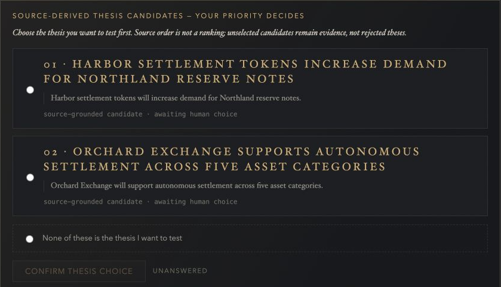
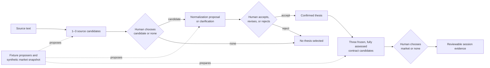

# FitCheck — an Epistemic Ledger reference

Epistemic Ledger is an agent-first project for helping people keep testable
theses connected to their source material, evidence, and explicit human
decisions over time. FitCheck is its first, deliberately narrow application:
assessing whether a prediction-market contract expresses an event-risk thesis.

FitCheck is evidence-first, not trade-first. It does not execute trades,
custody assets, recommend position sizes, or turn a weak proxy into a clean
expression. For example, a contract may capture an event's outcome while
missing the thesis's time horizon or target population; FitCheck should show
that mismatch rather than call it a clean expression. `no_clean_expression` is
a valid result only for the exact, non-empty, fully assessed displayed pool.



*An earlier v3.1 fixture screen, before the anonymous two-journey demo.*

## Product direction and public boundary

The product direction is to let a person turn source material into a
decision-ready, testable thesis, explicitly confirm its meaning, inspect
supporting and counterevidence, state disconfirming or revisit conditions, and
retain a human-owned history of revisions. Prediction markets are the first
expression surface, not a claim that every important thesis has a tradable
expression. FitCheck asks whether a checked contract is useful and explains
what it captures and misses; a market price does not establish that a thesis is
true.

Agents may eventually prepare bounded, provenance-linked work for that
process. They do not own thesis meaning, confidence, commitment, or semantic
review decisions. The intended source-selection and confirmation interaction
is recorded in the [v3.1 UI contract](docs/fitcheck-v3.1-ui-contract.md).

The local anonymous demo offers three offline journeys. Stablecoin/Robinhood
source interpretation runs through a fixture worker, explicit candidate
choice, clarification, and human confirmation. Each supported accepted thesis
compares three fixed, minimal synthetic test abstractions that preserve the
required demo edge cases, with curated proposals and complete fixture rules.
Any no-clean result applies only to those three fully assessed displayed
contracts. Unsupported thesis edits fail closed. The identities, provenance,
and fail-closed compatibility rules are in the
[v3 frozen market demo contract](docs/fitcheck-frozen-market-demo-contract-v3.md).
The separate Hormuz journey replays retained before/after market rules with
visitor-owned, clearly labelled test setup for thesis acceptance and market
choice. The AGI 2028 journey presents a read-only, authored reconstruction of
three real contract topics. It explains RSI as a weak proxy for a public
autonomous-AI-research demonstration by 2028 and keeps the earlier automatic
labels inspectable. Its condition summaries are paraphrases, not verbatim
rules or live data. The [recording script](docs/gtm-agi2028-demo-script-v1.md)
walks through the thesis, the mismatch and the scoped no-clean result.
The MCP fixture path retains its separate market-pool reference flow.
Legacy predecessor routes remain available for compatibility and are not the
default journey.

This reference does not ship a general thesis ledger, ongoing monitoring,
generic venture discovery, a production service, or a verified third-party
agent client. Offline tests can establish declared contracts; they cannot
establish semantic accuracy or user value. A generic-Gemini versus
complete-FitCheck normalization comparison requires the same cases and model,
followed by stage-specific blinded human review. It must not turn private
evaluation evidence, live-provider access, or a design direction into a public
product claim.

## System at a glance



Models and providers can propose evidence; they do not own durable truth.
Deterministic checks preserve declared policy, schema, provenance, and
bookkeeping; they do not establish semantic truth. The anonymous source demo
uses a durable fixture worker. For either exact supported thesis, it presents
the bound three-contract frozen pool and an explicit market-or-`none` choice.
Unsupported source edits fail unavailable. This is not a live-provider
workflow.

## Engineering evidence

| Claim | Implementation | Verification |
| --- | --- | --- |
| Background work has durable identity, idempotent submission, bounded retries, cancellation, leases, and stale-worker fencing. | [`el/jobs/store.py`](el/jobs/store.py) and the [worker schema migration](migrations/versions/a4d8c2e6f0b1_worker_job_snapshot_foundation.py) | [`tests/test_job_store.py`](tests/test_job_store.py) plus the real [`PostgreSQL contention gate`](tests/test_job_store_postgres.py) |
| A market-universe refresh is validated before promotion, with content identity separate from the active pointer. | [`el/retrieval/snapshot_worker.py`](el/retrieval/snapshot_worker.py), [`snapshot_validation.py`](el/retrieval/snapshot_validation.py), and [`snapshot_store.py`](el/retrieval/snapshot_store.py) | [`tests/test_snapshot_worker.py`](tests/test_snapshot_worker.py) |
| Classification binds a job to snapshot, index, policy, prompt, and model identities before applying a deterministic fit-policy result. | [`el/classification/worker.py`](el/classification/worker.py) and [`planner.py`](el/classification/planner.py) | [`tests/test_classification_worker.py`](tests/test_classification_worker.py) |
| The predecessor fit policy applies deterministic checks rather than accepting a model response unexamined. | [`el/fitgate/service.py`](el/fitgate/service.py), [`checks.py`](el/fitgate/checks.py), and [`policy.py`](el/fitgate/policy.py) | [`tests/test_fit_service.py`](tests/test_fit_service.py) and [`tests/test_fitgate_checks.py`](tests/test_fitgate_checks.py). These checks are declared policy mechanics, not an independent semantic authority. |
| A user correction creates review work without silently rewriting cards, decisions, or ledger truth. | [`el/product/api.py`](el/product/api.py) and [`el/review/candidates.py`](el/review/candidates.py) | [`tests/test_correction_loop.py`](tests/test_correction_loop.py) and [`tests/test_review_candidates.py`](tests/test_review_candidates.py) |
| Authenticated MCP tool invocations consume bounded, per-key weighted usage across instances before tool execution. | [`el/mcp/rate_limit.py`](el/mcp/rate_limit.py) and [`el/domain/tables.py`](el/domain/tables.py) | [`tests/test_mcp_rate_limit.py`](tests/test_mcp_rate_limit.py) and the [PostgreSQL contention gate](tests/test_job_store_postgres.py) |
| The public artifact is generated from an allowlist and fails closed on unexpected files, live identifiers, secrets, and private roots. | [`scripts/build_public_export.py`](scripts/build_public_export.py) and [`scripts/check_public_boundary.py`](scripts/check_public_boundary.py) | [`tests/test_public_export.py`](tests/test_public_export.py), [`tests/test_public_boundary.py`](tests/test_public_boundary.py), and the [public CI gates](.github/workflows/ci.yml) |

For the architectural reasoning, ownership boundaries, tradeoffs, and failure
handling behind those links, see the
[`engineering walkthrough`](docs/engineering-walkthrough.md).

## Implementation status

| Surface | Status | Boundary |
| --- | --- | --- |
| Anonymous source -> selected candidate -> confirmed thesis | **Public, offline fixture demo** | A local fixture worker processes the frozen two-thesis source. Each supported 2027 thesis has three newly written minimal synthetic market abstractions, separately attributed curated expression-quality proposals and automatic diagnostics, full fixture rules, and an explicit market-or-none choice. Unsupported edits fail unavailable; this is not a catalog search or a governed golden. |
| Hormuz retained-rules revisit | **Public, offline test reconstruction** | Exact retained old/new rules drive a visitor-owned change packet. Thesis acceptance and market choice are reconstructed test setup, not historical human decisions; semantic market fit is unassessed. |
| AGI 2028 contract comparison | **Public, read-only curated reconstruction** | Three authored condition summaries explain the difference between related evidence and a clean expression. RSI's weak-proxy label is a proposal; earlier labels remain inspectable. No live prices, new inference, human adjudication or private historical packet is included. |
| Accepted-thesis restoration | **Public, local fixture reference** | A read-only, actor-bound `accepted-state` view restores the original source and selected excerpt when their retained lineage is complete. It does not record another decision or automatically assess a market pool. |
| Persisted journey resume | **Public, local fixture reference** | Read-only account-state, source, market-pool, and market-choice views return only IDs and records owned by the prebound local actor or anonymous visitor session. The private account adapter is excluded, so these routes do not establish production authentication or multitenancy. |
| Legacy predecessor classify, blind-prior, draft, and simple-ledger routes | **Public compatibility reference** | Retained for replay and compatibility; they are not the default v3.1 journey. |
| Durable jobs, classification worker, and snapshot validation | **Public, separately tested foundations** | The anonymous source demo uses a separate fixture source worker. MCP has its own bounded fixture-worker reference. Public CI adds a disposable PostgreSQL contention gate. |
| Deterministic fit policies, correction intake, review queue, and MCP contracts | **Public, offline fixture reference** | MCP source interpretation also submits, runs, and polls a bounded fixture job. Anonymous demo requests are visitor-scoped and cannot enter correction/review or legacy ledger writes. Synthetic tests establish declared contracts, not live-data accuracy, production readiness, or a verified external client. |
| Cloud, provider, and operational runtime | **Not attested by this public repository** | Service identifiers, infrastructure configuration, database, credentials, and current operational evidence are excluded. |
| Live PolyData retrieval source and provider operations | **Excluded** | Provider implementation, credentials, payloads, retry policy, and authorization are absent; live-provider selection fails closed. |
| Governed review corpus and reported evaluation rows | **Private** | Public fixtures are regression material, not the governed benchmark or evidence for external validity. |
| Trade execution, wallets, custody, and brokerage integration | **Out of scope** | FitCheck evaluates expression quality; it does not execute or advise trades. |

## What this public distribution contains

This repository is an offline-runnable and credential-free-by-default
distribution of the core domain services, deterministic policy gates, worker
contracts, local product surface, and a selected offline test suite. After
dependencies are installed, fixture-mode tests and the local product flow make
no network or model calls. Most included fixture data consists of synthetic
test material with fabricated or neutralized identifiers. The narrow
Hormuz retained-rules resource contains real historical rule text and approved
possible-effects copy for a labelled test reconstruction; it is not a market
feed, governed review corpus, or production evaluation corpus. The source
journey includes six newly written minimal synthetic market abstractions and
two synthetic event bindings identified in the data card. They preserve only
the required demo edge cases, use FitCheck-owned schemas, and are not provider
response bodies or provider schemas. Their identifiers, URLs, timestamps,
liquidity values, and event relationships are fabricated.

The AGI case instead uses authored summaries of real contract topics and says
so explicitly. Its earlier and current views are explanatory reconstructions,
not a new benchmark or an exact private-run replay.

FitCheck `0.2.0` uses this v3 synthetic-fixture format exclusively. Persisted
v1/v2 frozen-demo pools are unsupported at runtime and fail closed; they are
not relabelled or reprojected as v3 evidence.

The authoritative governed review corpus remains private. It contains review
provenance and source material whose redistribution rights and privacy
boundaries differ from those of the source code. Public experiment reports may
summarize governed measurements without publishing the underlying rows. See
the [`July 2026 reviewed-data measurement summary`](docs/experiments/README.md)
for the observed limitations and negative results.

The retrieval layer exposes a provider protocol, but this distribution ships
only fixture providers, including the exact-thesis `FrozenDemoMarketProvider`.
Live provider implementations, credentials,
payloads, retry policy, and operational configuration are absent.
`MARKET_PROVIDER=polydata` deliberately fails closed. Offline fixture mode
does not make network or model calls.

Any separately operated reference service is outside this public artifact. Its
service identifiers, database, secrets, deployment configuration, and current
operational state are not published here. The Docker image in this repository
runs the local fixture UI; it is not a reference deployment image.

## Quick start: anonymous fixture demo

Python 3.12 or newer is required. The full offline test suite also uses
Node.js 22 or newer for a dependency-free DOM regression; the fixture UI and
MCP server do not require Node.js at runtime.

```bash
python3.12 -m venv .venv
.venv/bin/python -m pip install -e ".[dev]"
PYTHONPATH=. .venv/bin/python -m pytest \
  tests/test_v3_reference_flow.py \
  tests/test_v3_async_source_jobs.py \
  tests/test_mcp_v3_fixture_ownership.py \
  tests/test_mcp_v3_worker_bootstrap.py \
  tests/test_mcp_v3_stdio_smoke.py \
  tests/test_public_v31_security.py
```

The focused v3.1 command passes without a provider or model call. Run the
broader offline suite separately after dependency installation:

```bash
.venv/bin/python -m pytest \
  --ignore=tests/test_job_store_postgres.py \
  --ignore=tests/test_mcp_schema_migration_postgres.py
```

Run the local fixture UI and source worker from one command:

```bash
PYTHONDONTWRITEBYTECODE=1 .venv/bin/fitcheck-demo \
  --db /tmp/fitcheck-demo.sqlite --host 127.0.0.1 --port 8100
```

Open `http://127.0.0.1:8100` and choose **Source discovery**, **Changed
market rules**, or **AGI 2028**. Source discovery queues a worker job for the frozen two-thesis
source; choose one candidate, answer its clarification, and accept or reject
the proposal. Each supported thesis (December 31, 2027) then compares three
frozen synthetic market fixtures, each with its own 2026 or 2027 rule deadline.
Inspect their curated expression-quality proposals, separate automatic diagnostics,
Yes/No conditions and complete rules, then choose one market or explicit none.
Four proposals are weak proxies and two are not expressions; these are fixture
proposals rather than human adjudications or goldens. Fixture version timestamps
are synthetic metadata, and no current prices or final outcomes are asserted.
The Hormuz journey shows exact retained before/after
rules, an evidence-bound revisit packet, and separate dismiss, reaffirm, and
revision-draft actions. Its prior acceptance and market choice are test-only
reconstruction. AGI 2028 compares three authored contract summaries with one
fixed thesis and allows inspection of earlier labels and the current
relatedness proposal. Open it directly with `?demo_history=agi2028`.
Each visitor has an isolated expiring session; switching
journeys resets it. The command creates or migrates a fresh local SQLite demo
database and starts web plus worker against that same path. An existing
unversioned database is rejected. No cloud account or provider/model credential
is needed. Use a distinct disposable SQLite path for each run.

### MCP fixture-worker checkpoint

The MCP source-interpretation protocol is separate from the UI. The canonical
offline end-to-end smoke is:

```bash
PYTHONDONTWRITEBYTECODE=1 PYTHONPATH=. \
.venv/bin/python -m pytest tests/test_mcp_v3_stdio_smoke.py
```

It opens SDK STDIO sessions, submits a fixture v3 source job, runs a separate
worker process, recovers the result by job ID and idempotency key, then calls
the source-choice, normalization, confirmation, market-pool, and market-choice
tools. Decision responses identify an `agent_relay`; they are not direct human
attestations. The test is a transport check using synthetic fixtures, not a
named-client compatibility claim.

To connect a local MCP client, launch the server from this checkout with
`command` set to the checkout's `.venv/bin/python` and `args` set to
`["-m", "demo.server"]`. Give that process these environment settings:

```text
PYTHONPATH=<absolute path to this checkout>
FITCHECK_DB_URL=sqlite+pysqlite:////tmp/fitcheck-v31-mcp.db
FITCHECK_PROPOSER=fixture
FITCHECK_MCP_TRANSPORT=stdio
FITCHECK_API_KEY=<local demo key retained for this database>
MARKET_PROVIDER=fixture
```

The client must show every source candidate and wait for an explicit user
decision before `v3_choose_source_candidate`, `v3_revise_normalization`,
`v3_accept_normalization` or `v3_reject_normalization`, and `v3_choose_market`.
Call `v3_assess_market_pool` only after acceptance, then retain the returned
display-set ID. A source job stays queued until the separate worker runs. For
a manually submitted fixture MCP job, migrate and run that worker against the
same MCP database, with no `FITCHECK_UI_DB_URL` override:

```bash
FITCHECK_DB_URL=sqlite+pysqlite:////tmp/fitcheck-v31-mcp.db \
.venv/bin/python -m alembic upgrade head
FITCHECK_DB_URL=sqlite+pysqlite:////tmp/fitcheck-v31-mcp.db \
PYTHONDONTWRITEBYTECODE=1 PYTHONPATH=. \
.venv/bin/python -m el.sourceinterpretation.worker --surface mcp-fixture --once
```

Do not treat the worker invocation as a deployed service or named-client
integration.

### Optional Google ADK client

The Google ADK client is an independent package under
[`clients/adk`](clients/adk/README.md). Install it in a clean client virtual
environment, separate from the FitCheck server environment, because their
tested OpenTelemetry dependency ranges are incompatible. Public CI installs
that package in its own job and runs credential-free connection-type contracts
with network access fenced and skips treated as failures. Those contracts do
not run an agent or make a provider call.

## Containerized fixture UI

```bash
docker build -t fitcheck-fixture .
docker run --rm -p 127.0.0.1:8080:8080 fitcheck-fixture
```

Then open `http://127.0.0.1:8080`. Keep the host-side port bound to loopback.
The cookie isolates local visitors but is not a production authentication or
deployment reference.

## Optional PostgreSQL integration tests

The public CI workflow runs `tests/test_job_store_postgres.py` and
`tests/test_mcp_schema_migration_postgres.py` against a temporary PostgreSQL 16
service. Locally, set `FITCHECK_POSTGRES_TEST_URL` to a disposable test database
before running those modules. Never point the tests at a shared or production
database.

## Design tradeoffs and failure modes

- Deterministic checks make declared policy inspectable. Their semantic
  effectiveness requires separate evaluation and human review; the published
  July experiments document limitations of the predecessor policy.
- Frozen snapshots preserve provenance and testability at the cost of
  freshness. The active pointer moves only after validation; a same-cutoff
  content conflict stops for operator review.
- A durable job ledger handles duplicate delivery, transient failure, lease
  expiry, cancellation, and retry exhaustion. It cannot make an unauthorized
  or unavailable provider succeed.
- Corrections are intentionally slower than direct mutation: they mint
  review candidates so a user disagreement cannot silently become evaluation
  truth.
- The public export favors a narrow, inspectable surface over mirroring the
  private repository. Contributions must be ported deliberately through the
  private review and re-export process.

## Honest limitations

- The public fixtures are small and non-representative. Passing
  them does not establish real-world retrieval recall, classification accuracy,
  calibration, or market coverage.
- Historical live-provider and predecessor deployment configuration are not
  included, so this repository cannot reproduce live retrieval or attest that
  the predecessor service still exists or has any current operational state.
- Dependency ranges are declared in `pyproject.toml`, but this distribution
  does not include an exact resolved dependency lock. It therefore claims an
  offline-runnable, credential-free fixture path—not byte-for-byte environment
  reproduction.
- Shared source-job modules retain bounded SourcePilot admission types and
  FULL31 job-type/budget-guard hooks as extension contracts. The public fixture
  launch path supplies neither private pilot provisioning nor a budget adapter;
  those declarations do not activate a pilot or provider call.
- The fixture UI has anonymous visitor isolation and is not an authentication,
  tenancy, metering, migration, or internet-exposure reference.

## Trust boundaries

- Models and live providers may propose evidence; deterministic gates and
  human review govern durable truth.
- Frozen fixtures are offline test truth. Live retrieval must not silently
  rewrite governed labels.
- Corrections create review candidates; they do not directly mutate goldens or
  ledger truth.
- Execution, wallets, custody, and brokerage integrations are out of scope.

See [`DATA_CARD.md`](DATA_CARD.md) for fixture limitations,
[`PUBLIC_REPO_BOUNDARY.md`](PUBLIC_REPO_BOUNDARY.md) for the export contract,
and [`SECURITY.md`](SECURITY.md) for private vulnerability reporting.

## License

The code, documentation, and newly written minimal synthetic fixture
abstractions in this public distribution are licensed under the
[Apache License 2.0](LICENSE). The retained Hormuz excerpts are declared
third-party historical market content in the [data card](DATA_CARD.md) and
[third-party notices](THIRD_PARTY_NOTICES.md); the Apache grant does not assert
ownership of that material. The six current market fixtures and two event
bindings use FitCheck-owned minimal schemas and are not provider response
bodies. Private governed data and other excluded artifacts are absent from
this distribution.

The exact retained Hormuz projection is included under
`hormuz-publication-risk-exception-v1`: redistribution rights remain
unverified, and the owner has explicitly accepted the residual publication
risk. See [the bounded exception](PUBLIC_REPO_BOUNDARY.md#hormuz-publication-risk-exception-v1).
